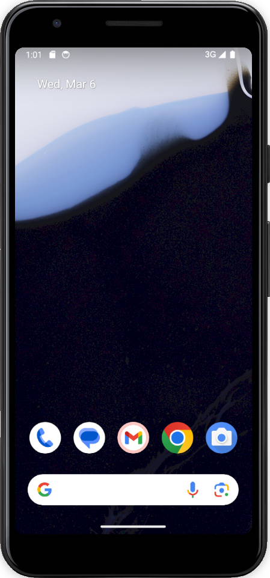
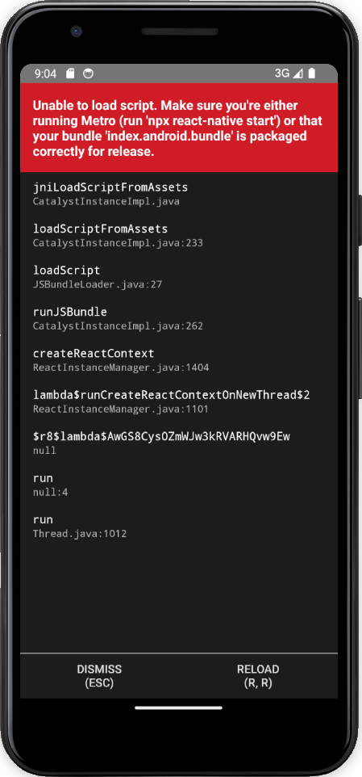
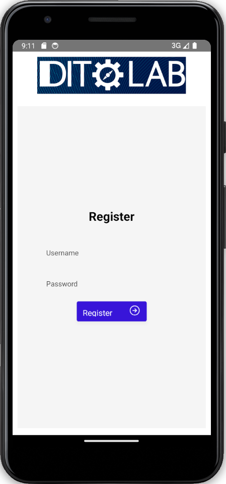

# Ubuntu install log

For testing purposes the [README](./README.md) instruction is followed on an Ubuntu laptop. The log 's been provided here...

## Essentials
```
$ lsb_release -r  
Release:	22.04

$ java -version  
openjdk version "11.0.22" 2024-01-16
OpenJDK Runtime Environment (build 11.0.22+7-post-Ubuntu-0ubuntu222.04.1)
OpenJDK 64-Bit Server VM (build 11.0.22+7-post-Ubuntu-0ubuntu222.04.1, mixed mode, sharing)

$ sdk install gradle

Downloading: gradle 8.6  
(...)  
Installing: gradle 8.6  
Done installing!  
Setting gradle 8.6 as default.

$ sudo apt install kotlin  
(...)

$ kotlinc -version  
info: kotlinc-jvm 1.3-SNAPSHOT (JRE 11.0.22+7-post-Ubuntu-0ubuntu222.04.1)
```

## Nix config
Skipped.

## Recommended next steps
Making sure native code dependencies are installed is skipped.

1. opened `~/Development/DitlabWallet` in terminal
2. ran `npm install`
3. opened virtual device in Android Studio  
.

4. ran `gradle wrapper` in `android/` dir
```
$ gradle wrapper

Welcome to Gradle 8.6!

Here are the highlights of this release:
 - Configurable encryption key for configuration cache
 - Build init improvements
 - Build authoring improvements

For more details see https://docs.gradle.org/8.6/release-notes.html

Starting a Gradle Daemon (subsequent builds will be faster)

FAILURE: Build failed with an exception.

* Where:
Build file '/home/steven/Development/DitlabWallet/android/app/build.gradle' line: 1

* What went wrong:
A problem occurred evaluating project ':app'.
> Failed to apply plugin 'com.android.internal.application'.
   > Android Gradle plugin requires Java 17 to run. You are currently using Java 11.
      Your current JDK is located in /usr/lib/jvm/java-11-openjdk-amd64
      You can try some of the following options:
       - changing the IDE settings.
       - changing the JAVA_HOME environment variable.
       - changing `org.gradle.java.home` in `gradle.properties`.

* Try:
> Run with --stacktrace option to get the stack trace.
> Run with --info or --debug option to get more log output.
> Run with --scan to get full insights.
> Get more help at https://help.gradle.org.

BUILD FAILED in 1m 11s
5 actionable tasks: 5 executed
```
5. installed OpenJDK Java 17  
`sudo apt-get install openjdk-17-jdk openjdk-17-jre`

```
$ java -version
openjdk version "17.0.10" 2024-01-16
OpenJDK Runtime Environment (build 17.0.10+7-Ubuntu-122.04.1)
OpenJDK 64-Bit Server VM (build 17.0.10+7-Ubuntu-122.04.1, mixed mode, sharing)
```
6. ran `gradle wrapper` in `android/` dir again

```
$ gradle wrapper
Starting a Gradle Daemon, 1 incompatible Daemon could not be reused, use --status for details
Path for java installation '/usr/lib/jvm/openjdk-17' (Common Linux Locations) does not contain a java executable

> Configure project :react-native-reanimated
Android gradle plugin: 8.1.1
Gradle: 8.6

FAILURE: Build failed with an exception.

* What went wrong:
A problem occurred configuring project ':react-native-reanimated'.
> SDK location not found. Define a valid SDK location with an ANDROID_HOME environment variable or by setting the sdk.dir path in your project's local properties file at '/home/steven/Development/DitlabWallet/android/local.properties'.

* Try:
> Run with --stacktrace option to get the stack trace.
> Run with --info or --debug option to get more log output.
> Run with --scan to get full insights.
> Get more help at https://help.gradle.org.

Deprecated Gradle features were used in this build, making it incompatible with Gradle 9.0.

You can use '--warning-mode all' to show the individual deprecation warnings and determine if they come from your own scripts or plugins.

For more on this, please refer to https://docs.gradle.org/8.6/userguide/command_line_interface.html#sec:command_line_warnings in the Gradle documentation.

BUILD FAILED in 52s
5 actionable tasks: 5 up-to-date
```
7. added `sdk.dir = /home/steven/Android/Sdk/` in
`local.properties` in `android/` dir
8. ran `gradle wrapper` in `android/` dir again
```
$ gradle wrapper
Path for java installation '/usr/lib/jvm/openjdk-17' (Common Linux Locations) does not contain a java executable

> Configure project :react-native-reanimated
Android gradle plugin: 8.1.1
Gradle: 8.6
Checking the license for package NDK (Side by side) 25.1.8937393 in /home/steven/Android/Sdk/licenses
License for package NDK (Side by side) 25.1.8937393 accepted.
Preparing "Install NDK (Side by side) 25.1.8937393 v.25.1.8937393".
"Install NDK (Side by side) 25.1.8937393 v.25.1.8937393" ready.
Installing NDK (Side by side) 25.1.8937393 in /home/steven/Android/Sdk/ndk/25.1.8937393
"Install NDK (Side by side) 25.1.8937393 v.25.1.8937393" complete.
"Install NDK (Side by side) 25.1.8937393 v.25.1.8937393" finished.

Deprecated Gradle features were used in this build, making it incompatible with Gradle 9.0.

You can use '--warning-mode all' to show the individual deprecation warnings and determine if they come from your own scripts or plugins.

For more on this, please refer to https://docs.gradle.org/8.6/userguide/command_line_interface.html#sec:command_line_warnings in the Gradle documentation.

BUILD SUCCESSFUL in 51s
6 actionable tasks: 6 executed
```
9. ran `npx react-native run-android` in root dir project

```
(...)
BUILD SUCCESSFUL in 3m 18s
211 actionable tasks: 206 executed, 5 up-to-date
info Connecting to the development server...
warn Failed to connect to development server using "adb reverse": spawnSync adb ENOENT
info Starting the app...
error Failed to start the app.
Error: Command failed with ENOENT: adb shell am start -n com.DitlabWallet7.com/com.DitlabWallet7.com.MainActivity -a android.intent.action.MAIN -c android.intent.category.LAUNCHER
spawnSync adb ENOENT
    at Object.spawnSync (node:internal/child_process:1124:20)
    at Object.spawnSync (node:child_process:876:24)
    at module.exports.sync (/home/steven/Development/DitlabWallet/node_modules/execa/index.js:174:25)
    at tryLaunchAppOnDevice (/home/steven/Development/DitlabWallet/node_modules/@react-native-community/cli-platform-android/build/commands/runAndroid/tryLaunchAppOnDevice.js:52:22)
    at /home/steven/Development/DitlabWallet/node_modules/@react-native-community/cli-platform-android/build/commands/runAndroid/runOnAllDevices.js:93:39
    at Array.forEach (<anonymous>)
    at runOnAllDevices (/home/steven/Development/DitlabWallet/node_modules/@react-native-community/cli-platform-android/build/commands/runAndroid/runOnAllDevices.js:88:48)
    at process.processTicksAndRejections (node:internal/process/task_queues:95:5)
    at async Command.handleAction (/home/steven/Development/DitlabWallet/node_modules/@react-native-community/cli/build/index.js:118:9)
info Run CLI with --verbose flag for more details.
```
10. installed adb via `$ sudo apt install adb`
11. ran `adb reverse tcp:8081 tcp:8081`
12. ran `npx react-native run-android` in root dir project again
```
$ npx react-native run-android
info Installing the app...
Starting a Gradle Daemon, 1 incompatible Daemon could not be reused, use --status for details
Path for java installation '/usr/lib/jvm/openjdk-17' (Common Linux Locations) does not contain a java executable

> Configure project :react-native-reanimated
Android gradle plugin: 8.1.1
Gradle: 8.6
Path for java installation '/usr/lib/jvm/openjdk-17' (Common Linux Locations) does not contain a java executable
WARNING: The specified Android SDK Build Tools version (31.0.0) is ignored, as it is below the minimum supported version (33.0.1) for Android Gradle Plugin 8.1.1.
Android SDK Build Tools 33.0.1 will be used.
To suppress this warning, remove "buildToolsVersion '31.0.0'" from your build.gradle file, as each version of the Android Gradle Plugin now has a default version of the build tools.

> Task :app:installDebug
Installing APK 'app-debug.apk' on 'Pixel_3a_API_34_extension_level_7_x86_64(AVD) - 14' for :app:debug
Installed on 1 device.

Deprecated Gradle features were used in this build, making it incompatible with Gradle 9.0.

You can use '--warning-mode all' to show the individual deprecation warnings and determine if they come from your own scripts or plugins.

For more on this, please refer to https://docs.gradle.org/8.6/userguide/command_line_interface.html#sec:command_line_warnings in the Gradle documentation.

BUILD SUCCESSFUL in 22s
211 actionable tasks: 10 executed, 201 up-to-date
info Connecting to the development server...
info Starting the app on "emulator-5554"...
Starting: Intent { act=android.intent.action.MAIN cat=[android.intent.category.LAUNCHER] cmp=com.DitlabWallet7.com/.MainActivity }
```

.

13. ran `npx react-native start` in root dir project
```
(...)
> Task :app:installDebug
Installing APK 'app-debug.apk' on 'Pixel_3a_API_34_extension_level_7_x86_64(AVD) - 14' for :app:debug
Installed on 1 device.

Deprecated Gradle features were used in this build, making it incompatible with Gradle 9.0.

You can use '--warning-mode all' to show the individual deprecation warnings and determine if they come from your own scripts or plugins.

For more on this, please refer to https://docs.gradle.org/8.6/userguide/command_line_interface.html#sec:command_line_warnings in the Gradle documentation.

BUILD SUCCESSFUL in 6s
211 actionable tasks: 10 executed, 201 up-to-date
info Connecting to the development server...
info Starting the app on "emulator-5554"...
Starting: Intent { act=android.intent.action.MAIN cat=[android.intent.category.LAUNCHER] cmp=com.DitlabWallet7.com/.MainActivity }
 BUNDLE  ./index.js 

 LOG  Running "DitlabWallet7" with {"rootTag":11}
```

## Result

.

